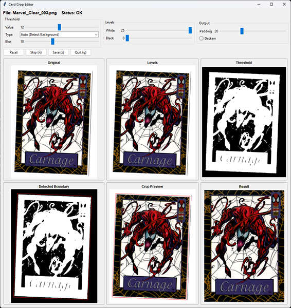
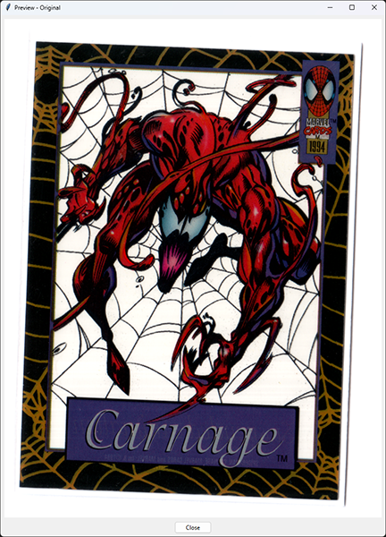
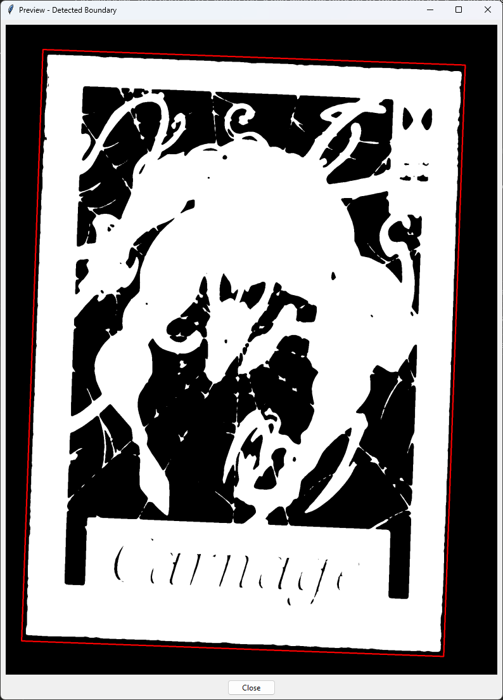
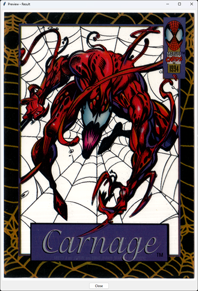

# Auto Card Crop

A windows application for automatically detecting, rotating, deskewing, and cropping documents, trading cards, photographs, and other rectangular media.

Auto Card Crop was originally developed as a python script an alternative to document scanning applications as alot of them where moving to the cloud to train AI Models. Rather than uploading images to cloud services, all processing is performed locally on the user's machine. The project was later converted to windows to support archival and trading card workflows, where precise alignment and consistent cropping are equally important.

---

## Features

- Automatic document and card detection
- Rotation and deskew correction
- Intelligent boundary detection
- Adjustable threshold processing
- Black and white level controls
- Configurable crop padding
- Real-time visual previews
- Batch processing support
- Fully local image processing

---

## Main Interface

The editor provides a complete processing pipeline, allowing users to fine-tune image detection before exporting the final result.



The interface includes:

- Original image preview
- Levels-adjusted preview
- Threshold preview
- Detected boundary visualization
- Crop preview
- Final output preview

---

## How It Works

### 1. Load Source Image

The original image before processing.



---

### 2. Image Processing & Detection

The application performs several processing steps to isolate the document or card from the background:

- Background noise reduction
- Contrast enhancement
- Black/white level adjustments
- Threshold generation
- Contour analysis
- Rotation estimation

The threshold image is used to determine the object's boundaries and orientation.

The red outline indicates the detected crop region and the transformation that will be applied to the final output.



---

### 3. Rotation and Crop

Once the boundary has been calculated, Auto Card Crop:

- Corrects rotation
- Removes unwanted borders
- Applies optional padding
- Produces a final aligned image



---

## Usage

For ease of use, opening via AutoCardCrop.bat will automatically check for a python instance plus the required dependencies and install them if nessasary.
After passing the check, a standard WindowsFileDialog will open for user to select files to process via the UI.

Alternativly the Python script can be called within a cli instance using the following arguments.

```[file|files]        - Name of file/files to process
    --dir               - Specify Input directory, '.' is supported.
    --threshhold_thresh - 0-255, Value for threshold strength.
    --threshhold_type  - Type of Threshold Method 
        0: THRESH_BINARY        - Preferable for Black Backgrounds
        1: THRESH_BINARY_INV    - Preferable for White Backgrounds
        2: THRESH_TRUNC
        3: THRESH_TOZERO
        4: THRESH_TOZERO_INV
    --blur              - 0-255,  Blur Kernal Size, useful for removing noise
    --pad               - Size in px, border around final cropped image
    --outdir            - Specify Output Directory relative to path, '.' is supported.
    --deskew            - Attempt to deskew the detected card/page
            
Usage: 
    Rotate.py file1.jpg [file2.jpg ...]
    Rotate.py file1.jpg [file2.jpg ...] --outdir [path]
    Rotate.py --dir [InputDirectory]
    Rotate.py file1.jpg --threshhold_thresh 130 --threshhold_type 0""")```